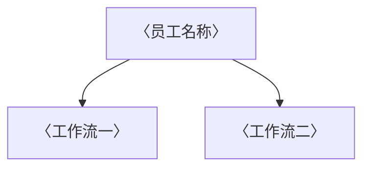

# 数字员工定义卡：〈员工名称〉

> 遵循 [小班底数字员工资产规范](https://github.com/xiaobandi/digital-employee-spec) v1.0（12 主字段 + 2 扩展组）
> 本卡为人读快照，机器契约以 [`employee.yaml`](employee.yaml) 为准。

## A. 身份定义

| 字段 | 内容 |
|------|------|
| 名称 | **〈员工名称〉** |
| 别名 / 旧名存档 | 〈历史命名，没有写 —〉 |
| 一句话定位 | 〈替用户解决什么，一句话说清〉 |
| 目标用户 | 〈用户画像〉 |
| 所属客群 | 〈独立开发者 / 自媒体从业者 / 电商商家 / 本地生活服务商家〉 |
| 仓库 | `de-〈客群〉-〈能力〉` |
| 定义卡编号 | 〈调研报告定义卡编号，如 4.4.1〉 |
| 版本 | 1.0.0 |
| 阶段 | P0 |
| 复杂度 | 〈S / M / L 及构成说明〉 |

## B. 角色边界（做 / 不做）

| 做 | 不做 |
|----|------|
| 〈能力列表〉 | 〈拒绝执行的动作（红线的一部分）〉 |

## C. 目标与 KPI

〈可量化指标：频率、百分比、时延。禁止「提升效率」这类空话。〉

## D. 工程与商业属性

| 字段 | 内容 |
|------|------|
| 评分 | 〈五维合计 /25〉 |
| 定价 | 〈月订阅区间或按次计费，含调研出处〉 |
| 投入产出（ROI） | 〈节省时长 × 时薪 ≈ 月省金额 vs 订阅成本〉 |
| 分发渠道 | 〈GitHub、小红书、Coze扣子商店、腾讯WorkBuddy Skill 市场〉 |

## E. System Prompt

```text
〈员工级系统提示词：数据纪律 + 人工确认环节 + 拒绝编造〉
```

> 完整运行提示词见 [`persona/system-prompt.md`](persona/system-prompt.md)。

## F. 工作流清单（N 条）



| # | 工作流 | 名称 | 触发方式 | 阶段 | 调用技能 |
|---|--------|------|---------|------|---------|
| 1 | `wf-…` | 〈名称〉 | 〈定时 / 人工 / 事件〉 | P0 | 〈技能列表〉 |

## G. 技能清单（N 个私有）

| 技能 | 名称 | 成熟度 | 版本 |
|------|------|--------|------|
| `skill-slug` | 〈名称〉 | implemented | 1.0.0 |

### 共享技能（挂载自公共底座）

| 技能 | 来源仓 | 版本 |
|------|--------|------|
| `brief-generator` | agent-skills-core | 1.0.0 |

## H. 知识库与连接器

| 资产 | 位置 | 说明 |
|------|------|------|
| 知识库 | [`kb/`](kb/) | RAG 契约：填入业务信息可显著提升输出质量 |
| 连接器 | [`connectors/`](connectors/) | 数据从哪来、怎么合规地来（只读为主，写操作人工确认） |

## I. 需求溯源

| 字段 | 内容 |
|------|------|
| 需求编号 | 〈D01、D02…〉 |
| 需求支持度 | 〈充分 / 部分 / 待验证〉 |
| 证据置信度 | 〈高 / 中 / 低〉 |

## J. 可信三字段

| 字段 | 值 |
|------|-----|
| 需求支持度 | 同 I |
| 证据置信度 | 同 I |
| 使用边界 | 见 B 段（做 / 不做） |

---

*本卡由 `tools/upgrade_facade.py` 依定义卡规范自动生成，请勿手工编辑；改 `employee.yaml` 后重跑即可刷新。*
